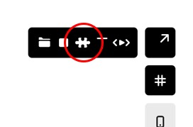
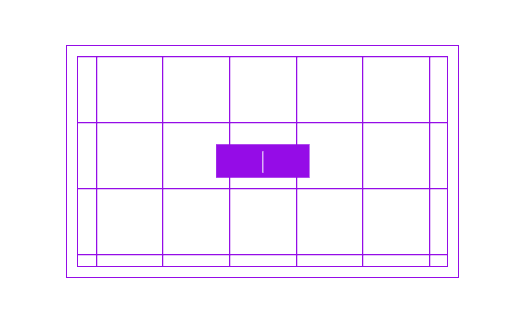

# Custom Components

One of the ways to customize Control page with your code is adding Custom Components.
Custom Components allow you to define a placeholder within a page using Editor and render a fully hand-coded React component version of an item.
In Beta, users of an Editor will not be able to see the registered component - it will only be visible on a published page.

# How to add Custom Items
1. In Editor, go to any page within your Control project.
2. In the Toolbar in the upper left corner, click on the puzzle icon



3. Drag on the page to create an area
4. Name your custom component in the properties panel



5. Publish your site in the Project dashboard
6. Create a React component in the `/components` folder and export it
6. In the codebase, navigate to `_app.tsx` and add the following code:

```tsx title=pages/_app.tsx
import { customItems } from '@cntrl-site/sdk-nextjs';
import { YourCustomComponent } from '../components/YourCustomComponent';

customItems.define('your-component-name', YourCustomComponent);
```

Done! You should see your custom component after running `npm run dev` and navigating 
to the page where you created the component.
