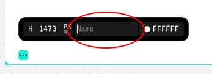

# Overriding sections

It often happens that the hand-coded content has dynamic height.  
In these cases a custom component wouldn't solve the problem -  
it is absolutely positioned and does not push the below content  
further down. In such cases, overridden sections come into play.

# How to override a section
1. In Editor, go to any page within your Control project.
2. Scroll to the very bottom of your artboard
3. Click on the Section Settings and enter section name (e.g `custom-section`):

4. In the code, open `pages/_app.tsx` and add the following code:
###
```tsx title=pages/_app.tsx
import { customSections } from '@cntrl-site/sdk-nextjs';
import { MyCustomSection } from 'components/MyCustomSection';

customSections.define('custom-section', {
  component: MyCustomSection,
  dataResolver: async () => ({ cmsData: 'CMS data here' })
});
```
Where `MyCustomSection` is your hand-coded component.  
Please take a look at the `dataResolver` field. This field  
allows you to pass a function (e.g call to some other API,  
CMS, etc), which will be resolved during build time, and  
the return value of this function will then be passed to  
the `MyCustomSection` component under `data` attribute.  

Make sure to also type your component props correctly,  
like this:

```tsx title=components/MyCustomSection.tsx
import { FC } from '@cntrl-site/sdk-nextjs';

interface Props {
  data: {
    cmsData: string;
  }
}

export const MyCustomSection: FC = ({ data }) => {
  return (
    <div>{data.cmsData}</div>
  );
};
```
