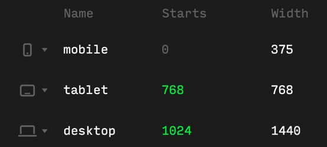

# Writing styles

You can use any styling approach you prefer:  
Tailwind, CSS-in-JS, inline styles etc. However,  
we recommend using SCSS modules as it allows you  
to use the same breakpoint rules as the ones that  
are configured in Control. We recommend you get  
familiar with how layouts/breakpoint work in Control.  

Visit `Project Dashboard -> Design -> Layouts` to see  
your current layout configuration.

# Problem
Let's say you're building a custom slider for a project  
that has three layouts: Mobile, Tablet and Desktop.  
Note the layouts configuration is also editable. You  
want the slider to have different style rules for all  
those layouts. But if you just copy-paste the values  
from Control and and hard-code them into your code, the  
next time a designer visits the Layouts config in Control  
and changes the breakpoints - your code won't reflect  
those changes.

# Solution: a CLI that generates .scss file

We've built a CLI tool that generates a single .SCSS file  
based on the layouts configuration in your specific  
project in Control.

This generation happens every time a project gets built,  
therefore it guarantees that the style variables are always  
up-to-date. It's also set up on a pre-build job, but you can  
trigger it manually by running this command from your  
project's root folder:
```
npm run generate-layouts
```
By default, if you don't pass it any options, it will create  
the following file: `styles/cntrl.scss`. You can change the  
location and name of the file by changing the script in your  
`package.json`.

# How to use the generated mixins
The generated file exports a single mixin called `for() {}`  
and a function called `size()`.

Let's see how we can use them in combination:
```scss
@import 'styles/cntrl';

.my-class-name {
  // common properties
  position: relative;
  // END common properties
  @include for('mobile') {
    padding-top: size(75);
  }
  @include for('tablet') {
    padding-top: size(192);
  }
  @include for('desktop') {
    padding-top: size(144);
  }
}
```
Let us explain them in detail.

This `for() {}` mixin takes a single argument - it's the  
layout name that corresponds to the layout name in Control.  
Calling the `size()` with the same value will return different  
result based on which mixin you're wrapping it with.

Let's take a look at this configuration in Control:



The top padding for mobile will yield to `20vw`:
```scss
@include for('mobile') {
  padding-top: size(75);
}
```
```
75 / 375 * 100 = 20vw.
```
Let's see how the full code block will look like when  
fully transpiled to simple CSS:
```css
.my-class-name {
  position: relative;
}
@media (max-width: 767px) {
  .my-class-name {
    padding-top: 20vw; /* 75 / 375 * 100 */
  }
}
@media (min-width: 768px) and (max-width: 1023px) {
  .my-class-name {
    padding-top: 25vw; /*192 / 768 * 100*/
  }
}
@media (min-width: 1024px) {
  .my-class-name {
    padding-top: 10vw; /*144 / 1440 * 100*/
  }
}
```
